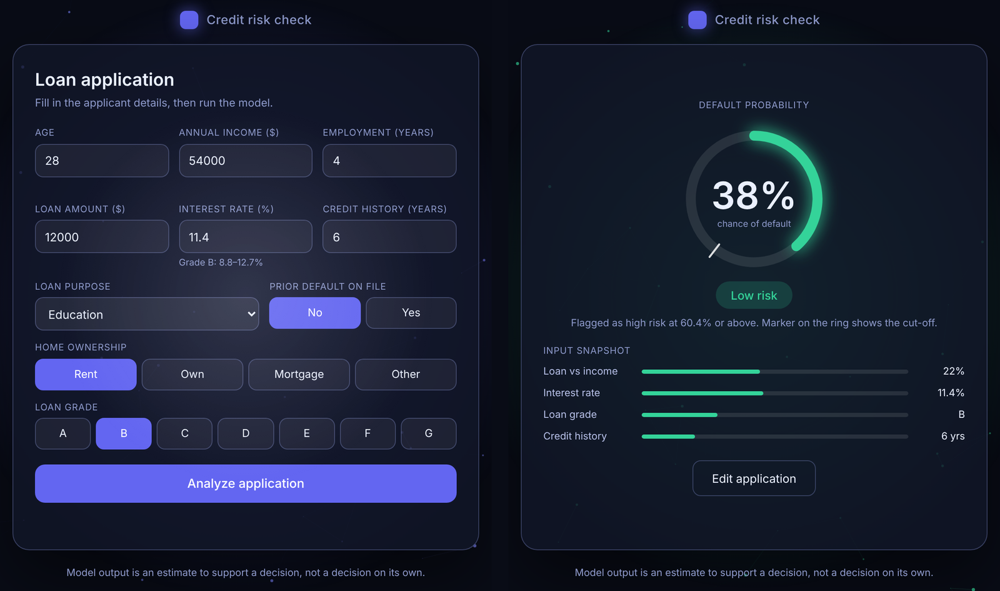

# 💳 Credit Risk Assessment — Loan Default Checker

Estimate the chance that a loan applicant will **default**, and turn that estimate into a simple decision: **low risk or high risk**.

🔗 **Live demo:** https://credit-risk-assesment-using-shap-08yl.onrender.com
📄 **API docs:** https://credit-risk-assesment-using-shap-08yl.onrender.com/docs

> The app runs on Render's free plan. If nobody has used it for a while, the first load can take 30–60 seconds while the server wakes up.



---

## Problem

A lender has to decide for **every application** whether the applicant is likely to pay the loan back.

- **Approving a defaulter**: the lender loses the money it lent.
- **Rejecting a good applicant**: the lender loses a paying customer.

A plain yes/no is not enough for this decision. The lender also needs to know **how likely** a default is, and that number has to be trustworthy. So this project gives a **calibrated probability** and a cut-off for each application:

| In the app | What it means | Model output |
|---|---|---|
| **Chance of default** | How likely this applicant is to default; 30% should really mean about 3 in 10 | Calibrated probability |
| **High risk / Low risk** | High risk when the chance of default is at or above the cut-off | Probability ≥ 60.4% |
| **Marker on the ring** | Where the cut-off sits, so you can see how far the applicant is from it | Decision threshold |

---

## Dataset

**Credit Risk Dataset**, Kaggle
https://www.kaggle.com/datasets/laotse/credit-risk-dataset

- **32,581 loan applications**, each with **11 input features** and the outcome (`loan_status`: 1 = defaulted, 0 = repaid).
- Features: age, income, home ownership, employment length, loan purpose, loan grade (A–G), loan amount, interest rate, loan as a share of income, prior default on file, and credit history length.
- The target is **imbalanced**: about **22%** of applicants defaulted.
- Missing values: `person_emp_length` (895 rows) and `loan_int_rate` (3,116 rows).

The raw file is included in this repo at `credit_risk_dataset.csv`.

---

## Approach

All steps are in `Credit_Risk.ipynb`, one section per step.

### 1. Cleaning (sections 2–3)
- Removed **165** exact duplicate rows.
- Removed impossible ages (outside 18–100), for example an age of 144.
- Removed employment length above 60 years or above the applicant's age.
- Removed rows with income or loan amount ≤ 0.
- **Kept rows with missing values.** They are filled in inside the model pipeline. A plain `emp_length <= age` filter would silently drop every row with a missing employment length, because a comparison with NaN is always false.
- Result: **32,409 rows**.

### 2. Split, imbalance and preprocessing (sections 4–6)
- **80/20 stratified train-test split**, so both parts have the same share of defaulters.
- Class imbalance: `class_weight="balanced"` for Logistic Regression and `scale_pos_weight` (≈3.57) for XGBoost.
- Preprocessing lives **inside one scikit-learn `Pipeline`**: median imputation for numbers (plus scaling for Logistic Regression), constant imputation + one-hot encoding for categories. The API sends raw values and gets exactly the same preprocessing as training.

### 3. Honest evaluation setup (sections 7–8)
- **5-fold stratified cross-validation** on the training data for every comparison and tuning decision.
- The **test set (6,482 applicants)** is used **once**, at the very end.
- The decision threshold is also picked **without the test set** (see step 5).

### 4. Model (sections 9–10)
- **Baseline:** Logistic Regression.
- **Main model:** XGBoost, tuned with `RandomizedSearchCV` (150 candidates × 5 folds), optimising **average precision**, with a fixed `random_state` so every run gives the same model.

### 5. Calibration and threshold (sections 12–13)
- **Sigmoid (Platt) calibration** with `CalibratedClassifierCV`, so the probability matches the real default rate. Brier score improved from **0.0608 to 0.0511**.
- **Threshold:** out-of-fold predictions on the **training data**, then the threshold with the best F1 score: **0.604**.

### 6. Explainability and error analysis (sections 14–15)
- **SHAP** summary plot shows which features drive the predictions overall.
- **SHAP waterfall** plot shows why one applicant got their score.
- False positives and false negatives on the test set are compared to see where the model is weak.

### 7. Saving the model (section 16)
- Saved with `model_io.save_portable`. A plain pickle of an XGBoost model trained on Linux fails to load on Windows (`XGBoostError: input stream corrupted`). The XGBoost part is stored in XGBoost's portable format instead, so the same file loads on **Linux, Windows and macOS**.

---

## Results (held-out test set, 6,482 applicants, 1,418 defaults)

| Metric | Logistic Regression (cut-off 0.5) | **XGBoost, calibrated (cut-off 0.604)** |
|---|---|---|
| ROC-AUC | 0.872 | **0.953** |
| Precision | 0.539 | **0.957** |
| Recall | 0.782 | 0.758 |
| F1 | 0.638 | **0.846** |
| Accuracy | 0.806 | **0.940** |

**Business result:** at the deployed cut-off the model catches **1,075 of 1,418 defaulters (75.8%)** and wrongly flags only **48 of 5,064 good applicants (under 1%)**. When it says "high risk", it is right **95.7%** of the time.

### Limitations (being honest)
- **About 1 in 4 defaulters is missed** (343 false negatives). The cut-off maximises F1; a lender who cares more about catching defaulters can lower it and accept more false alarms.
- **The cut-off is not based on real costs.** A real lender would pick it from the cost of a default vs the profit from a good loan.
- **`loan_grade` and `loan_int_rate` are set by the lender** after its own risk review, so they already carry part of the risk signal.
- **One public dataset only.** The model is not validated on real lending data from any institution.
- No applicant with a prior default has grade A or B in the data, so the app does not allow that combination.

### Future work
- A cost-based threshold instead of the best-F1 threshold
- SHAP explanations for each applicant inside the app
- Monotonic constraints (for example, a higher interest rate should never lower the risk)
- Automated tests for the API and the model file
- A permanent prediction log (Postgres) and a scheduled drift check

---

## API

| Method | Endpoint | What it does |
|---|---|---|
| GET | `/` | Credit risk check web page |
| GET | `/health` | Status and whether the model is loaded |
| POST | `/predict` | Default probability, prediction and cut-off for one application; invalid input returns 422 |
| GET | `/stats` | Summary of logged predictions: total, high-risk rate, average probability, and the same per loan grade |

Example:
```bash
curl -X POST https://credit-risk-assesment-using-shap-08yl.onrender.com/predict \
  -H "Content-Type: application/json" \
  -d '{"person_age": 28, "person_income": 54000, "person_home_ownership": "RENT", "person_emp_length": 4, "loan_intent": "EDUCATION", "loan_grade": "B", "loan_amnt": 12000, "loan_int_rate": 11.4, "cb_person_default_on_file": "N", "cb_person_cred_hist_length": 6}'
```

---

## Monitoring: prediction log and data drift

A model is only reliable for the kind of applicants it was trained on. If real traffic starts looking different (lower incomes, higher interest rates), the scores slowly stop meaning what they used to, while the API keeps answering normally. Monitoring catches this.

**1. Prediction log (`db.py`).** Every `/predict` call is saved in a SQLite table with its inputs, probability, decision and cut-off. If the log can't be written, the prediction is still returned and the error is logged. A logging problem never breaks the API.

**2. `/stats`.** SQL queries over the log: total predictions, high-risk rate, average default probability, and the same numbers per loan grade.

**3. Drift check (`drift_check.py`).** Compares every feature in the log with the notebook's training split (same cleaning, same split), using the **Population Stability Index (PSI)**:

| PSI | Status | Meaning |
|---|---|---|
| < 0.10 | OK | No real change |
| 0.10 – 0.25 | WATCH | Some change, keep an eye on it |
| ≥ 0.25 | DRIFT | Big change: check or retrain the model |

```bash
python drift_check.py
```

It exits with code 1 when any feature shows DRIFT, so it can run as a scheduled job. With fewer than 100 logged predictions it doesn't judge drift, because there's too little data to tell drift from noise.

**Tested on two kinds of traffic,** 600 applicants each, sent through the API:

| Traffic | Result |
|---|---|
| Random applicants from the test set | All 11 features **OK** (highest PSI 0.023) |
| Same applicants with income halved and interest rate +4 points | **DRIFT** in exactly `loan_int_rate` (2.79), `person_income` (1.44) and `loan_percent_income` (1.02, because it depends on income). The other 8 stay OK. |

The model is calibrated, so the script also compares the **average predicted default** with the training default rate (21.9%). On normal traffic it was 24.1%. On the shifted traffic it jumped to 61.2%.

> **Limitation:** Render's free plan has a temporary disk, so the log is lost when the service restarts. With Docker, a volume keeps it (see below). For a permanent log on Render, the same table can live in Render's Postgres.

---

## Project structure

```
Credit-Risk-Assesment-using-SHAP/
├── Credit_Risk.ipynb          # EDA, cleaning, training, tuning, calibration, threshold, SHAP
├── credit_risk_dataset.csv    # raw data
├── main.py                    # FastAPI app: /predict, /health, serves the web page
├── model_io.py                # saves/loads the model so it works on any OS
├── db.py                      # SQLite prediction log + /stats queries
├── drift_check.py             # compares logged applicants with the training data (PSI)
├── credit_risk_model.pkl      # calibrated XGBoost pipeline (preprocessing + model)
├── best_threshold.pkl         # decision cut-off (0.604)
├── static/
│   ├── index.html             # credit risk check UI
│   ├── style.css
│   └── script.js
├── assets/screenshot.png
├── Dockerfile                 # container for the API
├── .dockerignore
├── requirements.txt
├── runtime.txt
└── .python-version            # 3.13.5
```

---

## Run it locally (Windows / PowerShell)

```powershell
git clone https://github.com/Akashbal1209/Credit-Risk-Assesment-using-SHAP.git
cd Credit-Risk-Assesment-using-SHAP
python -m venv venv
.\venv\Scripts\Activate.ps1
pip install -r requirements.txt
uvicorn main:app --reload
```

Then open http://127.0.0.1:8000.

To re-run the notebook, also install the notebook-only packages (jupyter, matplotlib, seaborn, shap) and keep `model_io.py` next to the notebook (in Colab, upload it first). Use the same library versions as `requirements.txt`, so the saved model loads on the server.

---

## Run it with Docker

The image has the same Python and library versions on every machine, so there's no "works on my laptop" problem.

```bash
docker build -t credit-risk-api .
docker run -p 8000:8000 credit-risk-api
```

Then open http://127.0.0.1:8000.

To keep the prediction log when the container is removed or restarted, put it on a volume:

```bash
docker run -p 8000:8000 -v credit-risk-data:/app/data credit-risk-api
```

- **Small image:** on Linux, the `xgboost` package also installs NVIDIA's GPU library (~800 MB). The API only predicts on CPU, so the image installs `xgboost-cpu` at the same version instead. Predictions are identical to the last decimal. Compressed image size went from 424 MB to 165 MB.
- **Only what the API needs:** the notebook, dataset and docs stay out of the image (`.dockerignore`).
- **Runs as a normal user**, not root.
- **Built-in health check:** Docker calls `/health` every 30 seconds and marks the container `healthy` or `unhealthy`.
- **Port from `$PORT`:** hosts like Render set it, and it defaults to 8000.

To deploy on Render with Docker, create a Web Service from this repo and pick **Docker** as the runtime. Render finds the `Dockerfile` by itself.

---

## Tech stack
Python 3.13 · pandas · scikit-learn · XGBoost · SHAP · FastAPI · Pydantic · Docker · Render
